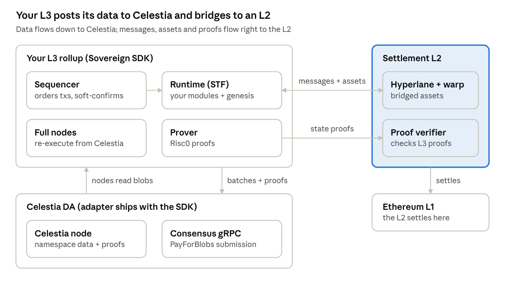

# Selendra L3

## Overview

Build the L3 with the Sovereign SDK and Celestia as its data availability (DA) layer: it is the SDK's main supported DA, with a working adapter, a local docker devnet and a demo you can run today. Avail was dropped from this plan because its adapter is excluded from the build, unfinished and unmaintained.

**What the Sovereign SDK is.** A Rust toolkit for building rollups ([repo](https://github.com/sovereign-labs/sovereign-sdk), checked at commit `9a3db73`, 13 Oct 2026). It gives you a module system (bank, accounts, paymaster, EVM, Hyperlane bridging), a full node with a soft-confirming sequencer, a NOMT-backed state store, and pluggable DA and zkVM adapters (Celestia, mock DA; Risc0, SP1).

**What "L3 on Celestia" means here.** A rollup that:

- posts its transaction batches and proofs to **Celestia** under its own namespaces (one for batches, one for proofs);
- runs its own sequencer and full nodes built from the Sovereign SDK;
- **settles / bridges to an L2** (for example Base or Arbitrum) instead of directly to Ethereum L1, using Hyperlane messaging and, optionally, ZK proofs verified on that L2.

A Sovereign rollup is "sovereign" by default: full nodes derive state from DA alone. The "L3" part comes from where you anchor the bridge and proofs, decided in Phase 2.

**The four parts you will build or run:**

1. **Celestia access**: a Celestia node (RPC) and a consensus gRPC endpoint, plus a funded TIA key. The adapter itself ships with the SDK.
2. **Rollup runtime (STF)**: the set of modules that defines your chain's logic, plus genesis.
3. **Node infrastructure**: sequencer, full nodes, prover.
4. **Bridge to the L2**: Hyperlane mailbox/warp modules on the rollup and contracts on the L2.

How these parts fit together:



The sequencer submits blobs through consensus gRPC; every node reads them back with proofs from a Celestia node. The highlighted L2 side is where the custom work now sits: the bridge and its security model.

## Prerequisites

You need a Linux or macOS machine with Rust, Docker and enough RAM to compile a large Rust workspace; testnet adds a Celestia node and testnet TIA, and production adds servers, mainnet TIA and a license notice to Sovereign Labs.

**Software**

| Tool | Version / note |
| --- | --- |
| Rust | `1.93.0`, pinned by `rust-toolchain.toml` (rustup installs it automatically) |
| cargo-nextest | Test runner the repo expects (`make install-dev-tools`) |
| Docker + Compose | Runs the local Celestia devnet (`celestia-app v8.0.1-mocha` validator, `celestia-node v0.30.1-mocha` bridge) and the observability stack |
| GitHub registry login | The devnet pulls images from `ghcr.io`: `docker login ghcr.io` with a personal access token |
| `jq`, `curl` | Used in the demo's sanity checks |
| Risc0 or SP1 toolchain | Only when you build ZK guests; skip with `SKIP_GUEST_BUILD=1` during development |
| celestia-node | For testnet/mainnet: a light or bridge node you run, or a hosted RPC provider |
| Foundry or Hardhat | For deploying Hyperlane contracts on the L2 |

**Hardware (development)**: 8+ CPU cores, 32 GB RAM, 100 GB free SSD. ZK proving with real provers needs a GPU machine or a proving network (e.g. Succinct for SP1).

**Accounts and keys**

- A Celestia wallet for the sequencer that pays for blobs (hex private key, exported with `cel-key` or `celestia-appd keys export`); testnet TIA from the Mocha faucet.
- Two Celestia namespaces for your chain: one for batches, one for proofs (set in `constants.toml`).
- Rollup keys: sequencer, prover, token deployer, admin. The repo's `examples/test-data/keys` and `docker/credentials` keys are public test keys; never use them beyond localhost.
- An L2 wallet with gas for deploying bridge contracts (testnet first).

**Knowledge**: Rust (traits, async/tokio), Celestia basics (namespaces, blobs, PayForBlobs fees, light vs bridge nodes), rollup concepts (sequencer, DA, proofs), and Hyperlane basics for the bridge.

**License**: the SDK's commercial components are under the [Sovereign Permissionless Commercial License](https://github.com/sovereign-labs/sovereign-sdk/blob/dev/LICENSE.md). Free for non-production R&D; production requires notifying info@sovlabs.io beforehand, integrating the `sov-revenue-share` module, a 10% gross revenue share, and an OFAC-compliant sequencer. With the Celestia acquisition, confirm the current contact and terms.

## Repository tour

Eight places in the repo matter for this chain; the default branch is `dev`.

| Path | What it gives you | What you do with it |
| --- | --- | --- |
| `crates/adapters/celestia` | Celestia `DaService` + `DaVerifier`: fetches namespace data with NMT inclusion/absence proofs, checks completeness, submits blobs over gRPC, failover, `lz4` compression, metrics | Use as-is; read its README to understand what the verifier proves |
| `examples/demo-rollup/src/celestia_rollup.rs` | `CelestiaDemoRollup` blueprint: Celestia DA + Risc0 + your runtime | Copy into your project as the node's blueprint |
| `examples/demo-rollup/configs/celestia_rollup_config.toml` | Fully commented node config: `[da]`, `[storage]`, `[runner]`, `[sequencer]`, `[proof_manager]`, `[monitoring]` | Base for your local, testnet and mainnet configs |
| `constants.toml` | `BATCH_NAMESPACE` / `PROOF_NAMESPACE` (10 bytes each), `MAX_TX_SIZE`, compression limits, chain constants | Set your chain's own namespaces before genesis |
| `docker/docker-compose.celestia.yml`, `docker/celestia/` | Local Celestia devnet: one validator (gRPC 9090) + bridge node `sequencer-0` (RPC 26658) | Local development and CI |
| `examples/test-data/genesis/demo/celestia` | Genesis for the Celestia demo | Template for your genesis |
| `crates/module-system` | Modules: `sov-bank`, `sov-accounts`, `sov-paymaster`, `sov-evm`, `sov-sequencer-registry`, `sov-prover-incentives`, `sov-attester-incentives`, `sov-revenue-share`, `sov-timelock`, `hyperlane` (mailbox, IGP, warp) | Compose your runtime; add your own modules from `module-template` |
| `examples/demo-rollup/README_CELESTIA.md` | Step-by-step guide for the local Celestia demo, multiple nodes, second sequencer | Follow it in Phase 1 |

Useful extras: `src/migrations/mockda_to_celestia.rs` (move a mock-DA chain onto Celestia), `crates/adapters/celestia/src/checker.rs` (checks for production settings), `sov-benchmarks` and `rest-api-load-testing` (load tests), and [rollup-starter](https://github.com/Sovereign-Labs/rollup-starter) for a smaller starting template.

## Phase 1 — Local development

Goal of this phase: your own rollup running on your machine against a local Celestia devnet, accepting transactions, producing proofs, and syncing a second node. No adapter work is needed; you configure what the SDK ships.

### Step 1.1 — Run the demo on mock DA

This proves your toolchain works before Docker and Celestia enter the picture.

```bash
git clone https://github.com/Sovereign-Labs/sovereign-sdk
cd sovereign-sdk/examples/demo-rollup
export SKIP_GUEST_BUILD=1        # skip ZK guest builds while developing
make build                       # cargo build --bins (mock DA)
make clean                       # wipe old data
../../target/debug/sov-demo-rollup   # leave running; REST on 127.0.0.1:12346
```

In a second terminal: `make test-create-token`. You should see `Rollup has processed the submitted batch!`.

### Step 1.2 — Run the demo on a local Celestia devnet

```bash
echo $GITHUB_TOKEN | docker login ghcr.io -u $GITHUB_USER --password-stdin   # once
cd sovereign-sdk/examples/demo-rollup
make build-celestia              # --no-default-features --features celestia_da
make clean
make start                       # validator (gRPC :9090) + bridge node sequencer-0 (RPC :26658)
make print-jwt-token             # bridge RPC auth token
export SOV_CELESTIA_RPC_AUTH_TOKEN=<token from above>
../../target/debug/sov-demo-rollup --da-layer celestia \
  --rollup-config-path configs/celestia_rollup_config.toml \
  --genesis-config-dir ../test-data/genesis/demo/celestia
```

Then `make test-create-token` in a second terminal; the node log shows `Received 1 blobs at height …`. Use `make logs` for devnet logs and `make stop` when done. The full walkthrough, including `sov-cli` transfers and the REST check of token supply, is in `examples/demo-rollup/README_CELESTIA.md`.

> The repo's `make start` writes a `demo_rollup_config.toml` and tries to inject the token, but its `sed` looks for an old key name (`celestia_rpc_auth_token`). Passing the token through `SOV_CELESTIA_RPC_AUTH_TOKEN`, as above, avoids that.

### Step 1.3 — Create your own rollup project

1. Start from [rollup-starter](https://github.com/Sovereign-Labs/rollup-starter), or copy `examples/demo-rollup` into a new workspace that depends on SDK crates pinned to one git tag or commit.
2. Keep only the Celestia blueprint (`celestia_rollup.rs`) and the `celestia_da` feature.
3. Set your own namespaces in `constants.toml`: `BATCH_NAMESPACE` and `PROOF_NAMESPACE`, 10 bytes each, distinct from `sov-test-b` / `sov-test-p` and from other chains.
4. Write your own config from `configs/celestia_rollup_config.toml` (keep secrets out of it; use the `SOV_CELESTIA_*` env vars).
5. Copy `examples/test-data/genesis/demo/celestia` and replace the test keys and addresses.

### Step 1.4 — Prove it works end-to-end

1. Submit transactions with `sov-cli` (`transactions import from-file …`, `node submit-batch`).
2. Run a second full node against the same devnet (`make create-second-celestia-config`, see "Several full nodes" in the Celestia README); confirm it reaches the same state root from Celestia data alone.
3. Turn on proving: `export SOV_PROVER_MODE=prove`, with a mock prover first and the real Risc0 guest next (unset `SKIP_GUEST_BUILD`).
4. Restart the sequencer mid-stream and check it recovers.

**Exit criteria for Phase 1**: your own rollup (own namespaces, own genesis) runs on the local devnet; two nodes agree on state; proofs post to the proof namespace; sequencer restart recovers cleanly.

## Phase 2 — Customizing the chain

Goal of this phase: decide what the chain does and how it connects to its L2, then encode that in the runtime, constants, genesis and bridge. These decisions are hard to change after launch.

### Runtime (what your chain does)

- **Pick modules** in your `Runtime` struct (see `examples/demo-rollup/stf/src/runtime.rs`). Baseline: `sov-accounts`, `sov-bank`, `sov-chain-state`, `sov-blob-storage`, `sov-sequencer-registry`, `sov-prover-incentives`, `sov-attester-incentives`, `sov-paymaster`, `sov-revenue-share` (mandatory for production under the license).
- **EVM or native?** Add `sov-evm` + `sov-ethereum` for Solidity contracts and MetaMask; otherwise write Rust modules from `module-template`. Address type: the demo uses `MultiAddressEvmSolana`.
- **Your business logic**: one module per domain. Keep it deterministic (no system time, no random, no `HashMap` iteration order), or proofs break.

### Constants and Celestia settings

- `BATCH_NAMESPACE`, `PROOF_NAMESPACE`: your chain's permanent addresses on Celestia; changing them later is a hard fork.
- `MAX_TX_SIZE` and `[sequencer] max_batch_size_bytes` (1 MiB in the demo): keep each batch within one Celestia blob.
- `[da] compression = "lz4"`: cuts blob fees; turn it on only once every node and prover reads compressed blobs.
- `[da] tx_priority`, backoff and timeout settings: tune for ~3 s Celestia blocks and your latency target.

### Genesis and economics

- Gas token: create it in `bank.json` with name, supply and initial holders.
- Sequencer bond and registration in `sequencer_registry.json` (its Celestia address is the blob signer); prover/attester bonds in their files.
- Fee policy: base fee, paymaster rules for gasless onboarding, and the revenue-share split. Budget TIA for blob fees in the sequencer's costs.
- Chain ID, `state_version` and code commitments in `chain_state.json` (`--override-code-commitments` computes them from the guest ELFs).

### Making it an L3: the bridge to your L2

| Decision | Options | Recommendation |
| --- | --- | --- |
| Settlement L2 | Base, Arbitrum, Optimism, any EVM L2 | The L2 where your users and liquidity already are |
| Messaging | Hyperlane (built in: `crates/module-system/hyperlane`) | Hyperlane; it ships mailbox, merkle-tree hook, IGP and warp-route modules |
| Security of inbound messages (ISM) | Multisig validators, or ZK proof of rollup state | Start multisig on testnet; move to proof-based verification before production |
| DA proof on L2 | None (trust validators), or Celestia's Blobstream (legacy since Sept 2026) | Plan without it: SP1 Blobstream gets no new commitments, so either run your own Blobstream-style verifier or document a validator-attested model |
| Asset bridge | Hyperlane warp routes (collateral on L2, synthetic on L3) | Warp routes for the gas token and stablecoins |

Steps:

1. Add `Mailbox`, `MerkleTreeHook`, `InterchainGasPaymaster` and `Warp` to the runtime (per the crate README); `sov-cli` already has subcommands for them.
2. Deploy Hyperlane core contracts and a warp route on the L2 testnet with the Hyperlane CLI (`docker/hyperlane` has a CLI image).
3. Run Hyperlane validators (sign checkpoints from your rollup) and a relayer (delivers messages both ways).
4. Test a round trip: lock tokens on L2 → mint on L3 → burn on L3 → release on L2.

### Proving

- The Celestia blueprint uses **Risc0** as the inner zkVM (`Risc0`, `Risc0CryptoSpec`); SP1 is wired only for mock DA today, so switching costs blueprint work.
- Decide proof cadence (`[proof_manager] aggregated_proof_block_jump`) and who runs provers (you, or a market via `sov-prover-incentives`).
- If the L2 bridge verifies proofs, deploy the zkVM verifier contract on the L2 and connect it to your ISM.

**Exit criteria for Phase 2**: runtime, namespaces and genesis frozen for testnet v1; bridge round trip works locally (mock L2 such as Anvil); proofs generate with the real zkVM.

## Phase 3 — Live testnet (Celestia Mocha + L2 testnet)

Goal of this phase: a public testnet of your L3 that posts to Celestia's **Mocha** testnet and bridges to an L2 testnet (e.g. Base Sepolia), run like production so problems show up before mainnet.

**Version check first.** Mocha restarted as a new chain, `mocha-5`, after `mocha-4` shut down on Sept 1, 2026; old blobs and Hyperlane state did not carry over. Mocha now runs celestia-node `v0.34.3-mocha` and celestia-app `v10.4.0-mocha`, while the SDK's adapter README and devnet images target `v0.30.1` / `v8.0.1`. Before deploying, confirm with Sovereign/Celestia (or test yourself) that your SDK version works against `mocha-5`.

### Celestia Mocha reference

| Item | Value |
| --- | --- |
| Chain ID | `mocha-5` |
| Consensus gRPC (blob submission) | `public-endpoint.celestia-mocha.quiknode.pro:9090` (TLS, dev only); `grpc-mocha.pops.one:9090`; `celestia-testnet-grpc.itrocket.net:443` |
| DA node RPC (port 26658) | No public community endpoints: run your own light or bridge node |
| Faucet | [mocha.celenium.io/faucet](https://mocha.celenium.io/faucet) or Discord `#mocha-faucet` (`$request <addr>`, 10 TIA/week) |
| Explorer | [mocha.celenium.io](https://mocha.celenium.io) |
| Block time / limits | ~3 s blocks; 8 MiB max transaction, 32 MiB max block (mainnet parameters) |
| Namespace rules | Version 0, 10 user bytes; namespaces at or below `0x00…00FF` are reserved |

Sources: [Mocha testnet](https://docs.celestia.org/operate/networks/mocha-testnet), [mainnet parameters](https://docs.celestia.org/operate/networks/mainnet-beta), [namespace spec](https://github.com/celestiaorg/celestia-app/blob/v10.4.0/specs/src/namespace.md).

### Run a Celestia node for your chain

A light node (1 core, 500 MB RAM, 20 GB SSD) is enough for reading and submitting blobs; a bridge node (32 cores, 64 GB RAM, 2 TB NVMe) only if you want your own full DA data ([hardware](https://docs.celestia.org/operate/getting-started/hardware-requirements)).

```bash
celestia light init --p2p.network mocha
celestia light start --core.ip public-endpoint.celestia-mocha.quiknode.pro \
  --core.port 9090 --core.tls --p2p.network mocha
celestia light auth admin --p2p.network mocha    # -> SOV_CELESTIA_RPC_AUTH_TOKEN
```

Then in your node config `[da]`: `rpc_url = "ws://<your-node>:26658"`, `grpc_url` = a Mocha gRPC endpoint, plus fallbacks. Pass the signer key and tokens through `SOV_CELESTIA_SIGNER_KEY`, `SOV_CELESTIA_RPC_AUTH_TOKEN`, `SOV_CELESTIA_GRPC_AUTH_TOKEN`.

### Steps

1. **Accounts**: create the sequencer's Celestia key, export its hex private key, fund it from the faucet.
2. **Config**: point `[da]` at your own light node (RPC) and Mocha gRPC endpoints, with fallbacks. Keep `max_batch_size_bytes` well under the max transaction size.
3. **Genesis**: fresh testnet keys (never the repo's test keys), your final namespaces, chain ID, token supply, sequencer and prover bonds; publish the genesis files. Set `genesis_da_height` in `chain_state.json` to a recent Mocha height.
4. **Infrastructure** (one region to start, Linux VMs, Docker or systemd):
    - Sequencer node (8–16 vCPU, 32 GB RAM, NVMe) + your own Celestia light node.
    - 2+ full nodes behind a load balancer for public REST / ETH RPC, each with its own light node or a shared bridge node.
    - Prover machine for Risc0 (GPU); set `SOV_PROVER_MODE=prove`.
    - Observability: InfluxDB + Grafana (`scripts/start_observability.sh`), Telegraf address in `[monitoring]`.
5. **Bridge**: deploy Hyperlane core + warp route on the L2 testnet; run validators and a relayer against your public RPC; fund the relayer on both sides.
6. **Launch**: start the sequencer, then full nodes; check blobs appear under your namespace on Celenium; confirm full nodes match the sequencer's state root.
7. **Open to users**: faucet for your L3 token, block explorer (`scripts/blockscout` for the EVM case), wallet setup docs.

### What to test on testnet

- Celestia edge cases: full blocks delaying your blob, gas price spikes, RPC/gRPC outage and failover, light node restart.
- Sequencer restart and recovery (`recovery_strategy = "TryToSave"`), and a full node syncing from genesis using only Celestia (mind the 169-hour default pruning window of Celestia nodes).
- Proof generation keeping up at peak load; proofs read back from the proof namespace by other nodes.
- Bridge round trips at volume, relayer outage, replay attempts.
- Upgrades: ship at least one runtime upgrade and one node upgrade on the live testnet.
- DA cost: measure TIA spent per batch and per day (gas = 65,000 + shares × 512 × 8; live gas price on [Celenium](https://celenium.io/constants)); compare with `lz4` compression on.

**Exit criteria for Phase 3**: testnet stable under target load with no manual intervention; every scenario above tested; DA and proving cost model known; all Phase 4 testnet-evidence gates checked.

## Phase 4 — Production readiness

You are ready for mainnet when every gate below is checked, not after a set period on testnet. The hardest gates are the security review of the DA verifier and bridge, and the license/support agreement; start those early.

### Go-live gates

**Code and security**

- [ ] Written go-ahead from Sovereign/Celestia Labs for the adapter and SDK version you ship (its README still says "Do not attempt to use in production"), or your own audit of `sov-celestia-adapter`'s verifier.
- [ ] External audit of your custom modules and the L2 bridge contracts; all high/critical findings fixed.
- [ ] Fuzzing on custom modules (the repo has a `crates/fuzz` setup to copy).
- [ ] SDK pinned to a tagged release; runtime, namespaces, genesis and code commitments frozen and reproducibly built.
- [ ] Bridge ISM moved off a small multisig: proof-based or a validator set you would trust with the bridged TVL.
- [ ] Upgrade and emergency-pause path defined (`sov-timelock`, admin keys, hard-fork procedure with `--stop-at-rollup-height` / `--start-at-rollup-height` or `sov-rollup-manager`) and rehearsed on testnet.

**Operations**

- [ ] Sequencer runs with a hot standby; failover rehearsed.
- [ ] Your own Celestia bridge or light node(s) plus fallback RPC and gRPC endpoints (`rpc_fallback_endpoints`, `grpc_fallback_endpoints`).
- [ ] At least 3 independent full nodes (yours + partners).
- [ ] Prover capacity sustains peak block rate with headroom; proof lag alerting.
- [ ] Monitoring: Grafana/InfluxDB stack (`scripts/start_observability.sh`), alerts on blob submission failures, TIA balance, DA lag, proof lag, bridge relayer health.
- [ ] Keys in a KMS/HSM or secret manager (sequencer TIA signer, rollup admin, bridge owner); nothing in config files.
- [ ] Runbooks: sequencer crash, Celestia RPC outage, stuck bridge message, bad state root, key compromise.
- [ ] Backups and state snapshot restore tested; pruning (`[storage.pruner]`) set.

**Testnet evidence**

- [ ] Load test at your target TPS with no DA backlog (`sov-benchmarks`, `rest-api-load-testing`).
- [ ] Chaos tests passed: kill sequencer, Celestia RPC loss, network partition (the repo uses toxiproxy).
- [ ] Bridge handled real user volume on testnet with zero lost or duplicated messages.
- [ ] Public bug bounty ran on testnet.

**Business and legal**

- [ ] Notified Sovereign Labs (info@sovlabs.io, or its Celestia Labs successor contact) and completed the revenue-share steps; `sov-revenue-share` integrated unmodified.
- [ ] Confirmed in writing that the license covers an L3.
- [ ] OFAC screening on the sequencer (address blocking, geofencing).
- [ ] TIA budget for blob fees and L2 gas for relayers funded, with auto top-up.
- [ ] Token, legal and compliance review for your jurisdiction.

### Production launch steps

1. Fund the mainnet sequencer's Celestia account with TIA; bring up your mainnet Celestia node(s) and fallbacks.
2. Deploy Hyperlane contracts + warp routes + verifier on the L2 mainnet.
3. Generate mainnet genesis (new keys, real token distribution, final namespaces) and publish it with the binary hash.
4. Start sequencer, full nodes, provers, Hyperlane validators and relayer; verify a canary transaction end-to-end and check its blob on a Celestia explorer.
5. Open the bridge with deposit caps; raise them as the system proves itself.
6. Publish RPC endpoints, explorer, docs and a status page.

## Risks, open questions and references

The biggest risks are now on the edges: an adapter officially labelled "not for production" that trails the live Celestia version, and a bridge that can no longer lean on Blobstream.

### Risks

| Risk | Impact | Mitigation |
| --- | --- | --- |
| Adapter labelled research-only and unaudited | Verifier bug breaks every proof | Get written support from Sovereign/Celestia Labs, or audit it; it is already used against mainnet |
| Adapter targets celestia-node `v0.30.1`; Mocha and mainnet run `v0.34.3` | Breakage on testnet or mainnet | Test against `mocha-5` early; track SDK releases that bump the version |
| SDK breaking changes (e.g. the Aug 2026 accounts hard fork) | Forced upgrades and migrations | Pin a tag; rehearse hard forks on testnet with `sov-rollup-manager` |
| Blobstream no longer maintained | L2 contracts cannot verify your data was published | Own verifier path, or a documented validator-attested model with deposit caps |
| L3 bridge security weaker than the L2 | Bridged funds at risk | Proof-based ISM before production; deposit caps |
| Celestia node pruning (169 h default) | New full nodes cannot sync from genesis | Run an archival bridge node or publish state snapshots |
| License fit for an L3 and changes after the acquisition | Legal exposure | Confirm terms in writing before production |
| DA and proving costs | Unit economics fail | Measure on testnet; enable `lz4` compression |

### Open questions

- [ ] Which L2 is the settlement layer?
- [ ] Does the current SDK release work with celestia-node `v0.34.x` on `mocha-5` and mainnet?
- [ ] Will Sovereign/Celestia Labs support your production deployment, and on what license terms for an L3?
- [ ] How will the L2 verify Celestia data now that Blobstream is legacy?
- [ ] EVM runtime (`sov-evm`) or native Rust modules only?
- [ ] Own Celestia light/bridge nodes, or a hosted provider (e.g. Quicknode) for mainnet?

### References

- [Sovereign SDK repo](https://github.com/sovereign-labs/sovereign-sdk) and [docs](https://docs.sovereign.xyz/2-running-starter.html)
- `examples/demo-rollup/README_CELESTIA.md` and `crates/adapters/celestia/README.md` in the repo
- [rollup-starter](https://github.com/Sovereign-Labs/rollup-starter)
- [Sovereign license and revenue share](https://docs.sovereign.xyz/8-0-complying-with-revenue-share.html)
- [Celestia Labs acquires Sovereign Labs](https://blog.celestia.org/celestia-labs-acquires-sovereign-labs-to-build-high-performance-custom-blockchains/) (Jul 15, 2026)
- [Mocha testnet](https://docs.celestia.org/operate/networks/mocha-testnet), [mainnet](https://docs.celestia.org/operate/networks/mainnet-beta)
- [Light node quickstart](https://docs.celestia.org/operate/data-availability/light-node/quickstart), [hardware requirements](https://docs.celestia.org/operate/getting-started/hardware-requirements)
- [Submitting data and fees](https://docs.celestia.org/learn/TIA/submit-data), [namespace spec](https://github.com/celestiaorg/celestia-app/blob/v10.4.0/specs/src/namespace.md)
- [Blobstream status](https://docs.celestia.org/learn/blobstream)
- [Hyperlane on Celestia](https://docs.celestia.org/learn/features/bridging/hyperlane), [Hyperlane docs](https://docs.hyperlane.xyz/)
