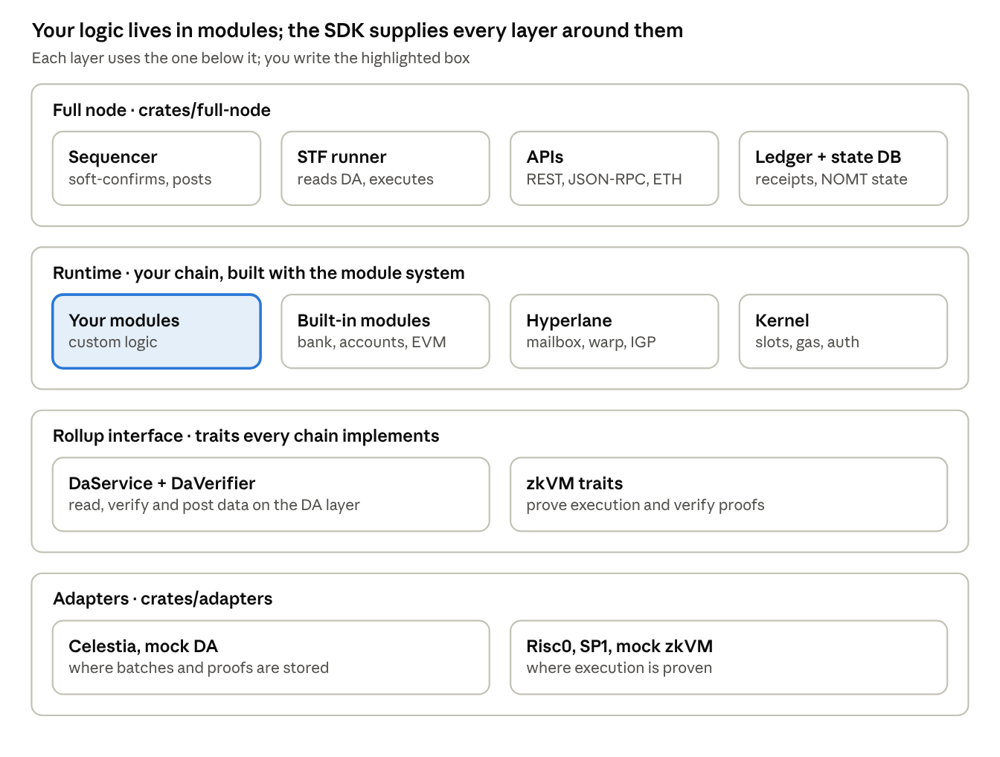

# Sovereign SDK — How It Works, Security, Custom Modules & Upgrades

Oct 19, 2026 · @Vuthy

## How it works

A Sovereign SDK chain is one Rust program, the **runtime**, that reads ordered transaction batches from a data availability (DA) layer such as Celestia, executes them, and proves the result with a zkVM. Everything below is based on the [sovereign-sdk repo](https://github.com/sovereign-labs/sovereign-sdk) at commit `9a3db73` (13 Oct 2026, branch `dev`).

**Four layers** (from the repo's `AGENTS.md`):

| Layer | Path | What it does |
| --- | --- | --- |
| Rollup interface | `crates/rollup-interface` | Core traits: `DaSpec`, `DaService`, `DaVerifier`, zkVM traits, state transition function (STF) |
| Module system | `crates/module-system` | Framework for modules (`sov-modules-api`), state (`sov-state`), runtime macros, kernels, capabilities, and ready modules (bank, accounts, EVM, Hyperlane …) |
| Adapters | `crates/adapters` | DA layers (Celestia, mock) and zkVMs (Risc0, SP1, mock) |
| Full node | `crates/full-node` | Sequencer, STF runner, ledger DB, REST / JSON-RPC / Ethereum RPC APIs, metrics |

**Key ideas**

- **Modules are the unit of logic.** A module is a Rust struct with its own namespaced state (`StateValue`, `StateMap`, `StateVec`). Modules cannot touch each other's state directly; they call each other's public methods.
- **Modules are fixed and trusted.** Unlike Ethereum smart contracts, users cannot deploy modules. The chain developer compiles them into the runtime. User-deployed contracts are possible only through a module that runs a VM, such as `sov-evm`.
- **The runtime wires modules together.** A `Runtime` struct lists every module; derive macros (`Genesis`, `Hooks`, `DispatchCall`, `Event`, `MessageCodec`, `RuntimeRestApi`) generate the glue: transaction decoding, dispatch to the right module's `call`, genesis, events and REST endpoints.
- **Same code, two modes.** Transactions run first in **native** mode (fast, on the node, recording a witness) and again inside the **zkVM** using that witness to produce a proof. Business logic is generic over `Spec`, so it does not change between modes; the storage backend does (`NomtProverStorage` natively, `NomtVerifierStorage` in the zkVM).
- **Kernel and capabilities.** Below the modules sits a kernel (the demo uses `SoftConfirmationsKernel`) that decides which batches run in which slot, plus capabilities for gas, authentication and sequencer rewards (`StandardProvenRollupCapabilities`).
- **State is a Merkle tree.** State lives in NOMT, a merklized key-value store; each block produces a state root that proofs commit to.
- **Three operating modes** (`OperatingMode`): `Zk` (validity proofs), `Optimistic` (attesters and challengers, via `sov-attester-incentives`), and `Operator`.

How the layers fit together:



You normally write only modules and the runtime that lists them; swapping the DA layer or zkVM means choosing a different adapter, not changing your modules.

## Transaction lifecycle

A transaction is confirmed by the sequencer in milliseconds, becomes final once its batch is on the DA layer, and becomes provable once a prover covers that block.

1. **Sign.** The user signs a transaction (Sovereign native, EVM/MetaMask or Solana signature, depending on the runtime's authenticator) over the chain's `CHAIN_HASH`.
2. **Submit.** The user sends it to the sequencer's REST API (or `sov-cli`, the TypeScript/Python SDKs).
3. **Soft-confirm.** The preferred sequencer checks it, executes it against its local state and returns a receipt immediately. Its batches are always processed first in a block, so this receipt is reliable if the sequencer is honest.
4. **Post to DA.** The sequencer bundles transactions into a batch blob and submits it to the DA layer under the chain's batch namespace (Celestia: `BATCH_NAMESPACE`).
5. **Execute.** Every full node reads the DA block, verifies the blobs are complete and correct for its namespace (`DaVerifier`), and runs the STF: kernel selects batches → authenticate each transaction → charge gas → dispatch to the module's `call` → commit or revert → new state root.
6. **Prove.** A prover re-executes the same blocks in the zkVM and posts an aggregated proof to the DA layer's proof namespace (cadence: `aggregated_proof_block_jump`). In optimistic mode, attesters post attestations and challengers can dispute them.
7. **Use the proof.** Light clients and bridges (e.g. a Hyperlane ISM on an L2) verify the proof instead of re-executing.

**Other paths in**

- **Regular registered sequencers** can post batches too; they run after the preferred sequencer's batches and cannot soft-confirm.
- **Forced inclusion:** if the preferred sequencer censors or stalls, a transaction posted straight to DA is still executed after at most `DEFERRED_SLOTS_COUNT` slots (120 in the demo `constants.toml`).

**What a failed transaction costs.** If a module's `call` returns an error, its state changes are reverted but the sender still pays gas used. If a batch cannot even be decoded or has invalid signatures, the sequencer that posted it is slashed (`SlashingReason::InvalidBatchEncoding`, `StatelessVerificationFailed`, `InvalidTransactionEncoding`).

## Security model

Safety comes from the DA layer plus deterministic re-execution and proofs; liveness comes from forced inclusion. The sequencer is trusted only for fast confirmations, and the module code you write is trusted completely.

### Who is trusted for what

| Party | Trusted for | If they misbehave |
| --- | --- | --- |
| DA layer (Celestia) | Ordering and availability of batches | Chain halts or forks with it; the SDK cannot fix a DA failure |
| `DaVerifier` (adapter) | Proving the blobs given to the STF are exactly the namespace's data | A bug here breaks every proof; it is compiled into the zkVM guest |
| Preferred sequencer | Fast soft-confirmations, ordering within its batches | Can delay transactions up to `DEFERRED_SLOTS_COUNT`, cannot forge state; bad batches get it slashed |
| Provers | Liveness of proofs | An invalid proof fails verification and the prover is slashed (`sov-prover-incentives`) |
| Attesters / challengers (optimistic mode) | Attesting to state roots | Wrong attestations can be challenged and slashed (`sov-attester-incentives`) |
| Full nodes | Nothing: each re-executes from DA | — |
| Your modules and runtime | Everything they do | No sandbox: a module bug is a chain bug |
| Chain admins (keys you configure) | Admin actions such as revenue-share control, paymaster, timelock | Use multisig and `sov-timelock` |

### Built-in protections

- **State isolation.** Each module's state is namespaced; other modules reach it only through public methods you write.
- **Replay protection.** Transactions are signed over `CHAIN_HASH` (derived from the runtime schema) and `CHAIN_ID`, and `sov-uniqueness` enforces nonces/generations.
- **Gas metering.** Compute and storage are charged automatically; per-call costs are set in `constants.toml` (e.g. `[gas.Bank]`). `BLOCK_GAS_LIMIT` caps each block.
- **Sequencer bonds and slashing.** Sequencers register with a bond (`sov-sequencer-registry`) and are slashed for undecodable batches or invalid signatures.
- **Censorship resistance.** Forced inclusion through DA after `DEFERRED_SLOTS_COUNT` slots.
- **Startup safety.** A binary refuses to run if `STATE_VERSION` does not match on-disk state; unknown config keys fail at startup.

### Rules for your code

1. **Be deterministic.** No system time, randomness, floating point that varies by platform, or `HashMap`/`HashSet` iteration order. Non-determinism breaks proofs and splits nodes.
2. **Check the sender.** `call` gets an authenticated `Context`; use `context.sender()` for authorization. Public methods like `bank.transfer_from` skip signature checks, so only call them after your module has the user's consent.
3. **Native-only code stays native.** Anything behind `#[cfg(feature = "native")]` (REST queries, metrics) must never affect state.
4. **Bound everything.** Limit loop sizes and stored data per call so gas reflects real cost.
5. **Return errors, do not panic.** An error reverts the transaction cleanly; a panic can halt nodes.
6. **Treat changes to state layout as upgrades.** Renaming fields or modules changes storage keys (see Upgrading).

### Status caveats

- The Celestia adapter's README calls it "research-only … not been audited"; get an audit or a written go-ahead from Sovereign/Celestia Labs before mainnet.
- `DEFERRED_SLOTS_COUNT` in the repo's `constants.toml` carries the note "Should be not copied … for production"; choose your own value.
- Report SDK vulnerabilities through a GitHub Security Advisory on the repo, never a public issue (`SECURITY.md`).

## Creating a custom module

Copy `crates/module-system/module-implementations/module-template` and rename it: it is a complete, compiling module with state, a call message, an event, genesis, a REST query and tests. The snippets below come from that template.

### Crate layout

| File | Purpose |
| --- | --- |
| `Cargo.toml` | Depends on `sov-modules-api` (+ other modules you call, e.g. `sov-bank`); features `native` and `arbitrary` |
| `src/lib.rs` | The module struct, its `Config`, and `impl Module` |
| `src/call.rs` | `CallMessage` enum (what users can send) and its handlers |
| `src/event.rs` | `Event` enum (what the module emits) |
| `src/genesis.rs` | Initial state at chain start |
| `src/query.rs` | Read-only queries for REST (native only) |
| `tests/` | Tests with `sov-test-utils` |

### 1. Define the module and its state (`lib.rs`)

```rust
#[derive(Clone, ModuleInfo, ModuleRestApi)]
pub struct ExampleModule<S: Spec> {
    #[id]
    pub id: ModuleId,                     // required
    #[state]
    pub value: StateValue<u32>,           // StateValue / StateMap / StateVec
    #[module]
    pub(crate) _bank: sov_bank::Bank<S>,  // other modules you call
}
```

`ModuleInfo` maps each `#[state]` field to its own storage key, and `ModuleRestApi` generates REST endpoints for the state.

### 2. Implement `Module` (`lib.rs`)

```rust
impl<S: Spec> Module for ExampleModule<S> {
    type Spec = S;
    type Config = ExampleModuleConfig;   // genesis config, read from JSON
    type CallMessage = CallMessage;
    type Event = Event;
    type Error = anyhow::Error;

    fn genesis(&mut self, _header: &<<S as Spec>::Da as DaSpec>::BlockHeader,
               config: &Self::Config, state: &mut impl GenesisState<S>) -> anyhow::Result<()> {
        self.init_module(config, state)
    }

    fn call(&mut self, msg: Self::CallMessage, context: &Context<S>,
            state: &mut impl TxState<S>) -> Result<(), Self::Error> {
        match msg {
            CallMessage::SetValue(v) => Ok(self.set_value(v, context, state)?),
        }
    }
}
```

### 3. Define user calls and events (`call.rs`, `event.rs`)

```rust
#[derive(Debug, PartialEq, Eq, Clone, JsonSchema, UniversalWallet)]
#[serialize(Borsh, Serde)]
#[serde(rename_all = "snake_case")]
pub enum CallMessage { SetValue(u32) }

impl<S: Spec> ExampleModule<S> {
    pub(crate) fn set_value(&mut self, new_value: u32, _context: &Context<S>,
                            state: &mut impl TxState<S>) -> Result<()> {
        self.value.set(&new_value, state)?;
        self.emit_event(state, Event::Set { value: new_value });
        Ok(())
    }
}
```

`UniversalWallet` lets wallets and `sov-cli` display and sign your messages; it also feeds the `CHAIN_HASH`. Use `context.sender()` for authorization checks.

### 4. Add queries (`query.rs`, native only)

```rust
pub fn query_value(&self, state: &mut ApiStateAccessor<S>) -> Response {
    Response { value: self.value.get(state).unwrap_infallible() }
}
```

### 5. Test it

```rust
generate_optimistic_runtime!(ExampleModuleRuntime <= example_module: ExampleModule<S>);

let mut runner = TestRunner::new_with_genesis(genesis.into_genesis_params(),
                                              ExampleModuleRuntime::default());
runner.execute_transaction(TransactionTestCase {
    input: user.create_plain_message::<RT, ExampleModule<S>>(CallMessage::SetValue(99)),
    assert: Box::new(|result, _| assert!(result.tx_receipt.is_successful())),
});
```

Run with `SKIP_GUEST_BUILD=1 cargo nextest run -p <your-module>`.

### Good practice

- Keep business logic in `pub(crate)` methods; expose only what other modules need as `pub`.
- Add gas costs for heavy calls in `constants.toml` (like `[gas.Bank]`).
- Use hooks (`Hooks` derive on the runtime) for begin/end-of-block logic instead of user calls.
- To build on another module, hold it as a `#[module]` field and call its public methods; never copy its state.
- If your module charges fees, route the share through `sov-revenue-share` (see the license).

## Applying a new module to the chain

Before launch, adding a module is a code change plus a genesis entry. After launch, the same change is a hard fork, because the runtime, `CHAIN_HASH` and ZK code commitment all change; follow the next section for that.

### Before launch (new chain or testnet reset)

1. **Add the dependency** to the runtime crate's `Cargo.toml` (in the demo: `examples/demo-rollup/stf/stf-declaration`), and pass its `native` feature through.
2. **Add a field to the `Runtime` struct** (`stf-declaration/src/lib.rs`):

    ```rust
    pub struct Runtime<S: Spec> /* where … */ {
        pub bank: sov_bank::Bank<S>,
        // … existing modules …
        pub my_module: my_module::MyModule<S>,   // new
    }
    ```

    The derive macros on `Runtime` (`Genesis`, `Hooks`, `DispatchCall`, `Event`, `MessageCodec`, `RuntimeRestApi`, `CliWallet`) pick it up automatically: transactions route to it, its events and REST endpoints appear, and `sov-cli` gets a subcommand.
3. **Wire genesis.** Add a path for `my_module.json` to `GenesisPaths` and read it in `create_genesis_config` (`stf/src/genesis_config.rs`); a module with an empty config uses `()`. Create the JSON file next to the other genesis files.
4. **Rebuild.** The build regenerates `CHAIN_HASH` and the wallet schema (`.artifacts/autogenerated.rs`) from the new runtime, and the zkVM guest gets a new code commitment. Rebuild the guest (unset `SKIP_GUEST_BUILD`) and refresh code commitments in `chain_state.json` (`--override-code-commitments`).
5. **Update clients.** Wallets and SDKs must use the new `CHAIN_HASH`/schema (served by the node's schema endpoint).
6. **Test**: unit tests on the module, then the demo flow on a local DA: submit a call with `sov-cli transactions import from-file my-module …`, check events and REST.
7. **Start the chain** from fresh genesis.

### After launch (live chain)

- `genesis` only runs at chain start, so a module added later starts with empty state. Initialize it with an offline state migration at the fork height, or with an admin-only call that sets it up on first use.
- Old signed transactions use the old `CHAIN_HASH`. Add the old hash to `CHAIN_HASH_OVERRIDES` in `constants.toml` with a `grace_period`, so in-flight transactions are still accepted.
- Add new modules at the end of `Runtime` and never reorder or rename existing ones or their `#[state]` fields: the call enum is Borsh-encoded by position, so reordering changes the wire format, and storage keys come from the names, so renaming makes existing state unreachable.
- Every node operator, prover and bridge verifier must switch binaries at the same height. That is the procedure in the next section.

## Upgrading the chain with new logic

A Sovereign chain has no on-chain "upgrade contract": new logic ships as a new node binary that every operator switches to at an agreed rollup height (a hard fork). The SDK gives you the pieces: stop/start heights, offline state migrations, chain-hash overrides and a process manager. The SDK's own Aug 2026 accounts hard fork (`STATE_VERSION` 0 → 1) is the reference procedure (see `CHANGELOG.md`, entry #2892).

### What counts as an upgrade

| Change | Needs a coordinated fork? | Why |
| --- | --- | --- |
| Node-only change (APIs, metrics, sequencer tuning, config) | No | Does not affect state or proofs; roll out node by node |
| Bug fix or new logic inside an existing module's `call` | Yes | Different execution results → different state roots and a new ZK code commitment |
| New `CallMessage` variant or new module | Yes | New `CHAIN_HASH` and wire format |
| Changed state layout or new module needing initial state | Yes, plus a state migration | Existing state must be rewritten at the fork height |
| Gas constants, namespaces, other `constants.toml` values | Yes | Compiled into both native and zkVM binaries |
| SDK version bump marked **Breaking** in the changelog | Usually yes | Follow that entry's migration notes |

### Step by step

1. **Build the new binary.** Implement the change, bump `STATE_VERSION` in `constants.toml` if state needs migrating, and add the old hash to `CHAIN_HASH_OVERRIDES` (with a `grace_period`) if the schema changed.
2. **Write the migration** (if needed) as a small binary wrapping the `sov-migrations` crate, like demo-rollup's `migrate_to_v1` (`--rollup-config-path`, `--db-path`, `--dry-run`). It runs offline on the node's NOMT database and bumps the stored state version. Make it idempotent.
3. **Choose the fork height N** in the future and announce it to every operator, prover, attester, bridge relayer and wallet/SDK team.
4. **Test on testnet first.** Run the full fork there: old binary stops at N, migration runs, new binary starts at N, all nodes agree on the state root, proofs verify.
5. **Run the fork on mainnet.**
    1. Restart the old binary with `--stop-at-rollup-height N`.
    2. When it stops, run the migration (`--dry-run` first to check the resulting state root).
    3. Start the new binary with `--start-at-rollup-height N`.
    4. Or let [`sov-rollup-manager`](https://github.com/Sovereign-Labs/sov-rollup-manager) do this: it wraps the node process and takes the list of binaries and their start/stop heights as config.
6. **Update the proof side.** The new guest has new code commitments, so provers must run the new guest from N, and any on-L2 verifier or bridge ISM must accept the new commitment from N.
7. **Update clients** to the new schema/`CHAIN_HASH` before the `grace_period` ends.
8. **Keep both binaries.** The fork height becomes part of consensus: a node syncing from genesis needs the old binary up to N and the new one after it.

### Safety habits

- Pin the SDK to a tag; read every **Breaking** entry in `CHANGELOG.md` before bumping.
- Gate changes behind `sov-timelock` or an admin multisig where an on-chain switch is enough (e.g. turning a feature on at a height you already shipped).
- Keep an emergency path: a pause in your modules and a rehearsed rollback plan (restart the old binary before N if the new one fails tests).

## References

In the [sovereign-sdk repo](https://github.com/sovereign-labs/sovereign-sdk) (branch `dev`):

- `AGENTS.md`: architecture overview and determinism rules
- `crates/module-system/README.md` and `RPC_WALKTHROUGH.md`: module system concepts (parts of the README predate the current API; prefer the template code)
- `crates/module-system/module-implementations/module-template`: the module to copy
- `examples/demo-rollup/stf/stf-declaration/src/lib.rs`: a full `Runtime`
- `examples/demo-rollup/stf/src/genesis_config.rs`: genesis wiring
- `constants.toml`: chain constants, gas, namespaces, `CHAIN_HASH_OVERRIDES`, `STATE_VERSION`
- `crates/utils/sov-migrations` and demo-rollup's `migrate_to_v1`: state migrations
- `CHANGELOG.md`: breaking changes and the hard-fork procedure (#2892)
- `SECURITY.md`: how to report vulnerabilities

Elsewhere: [Sovereign docs](https://docs.sovereign.xyz/2-running-starter.html), [rollup-starter](https://github.com/Sovereign-Labs/rollup-starter), [sov-rollup-manager](https://github.com/Sovereign-Labs/sov-rollup-manager).
